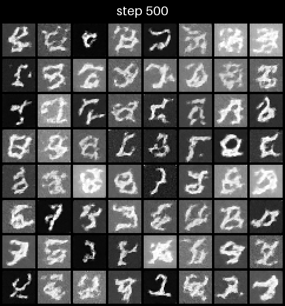
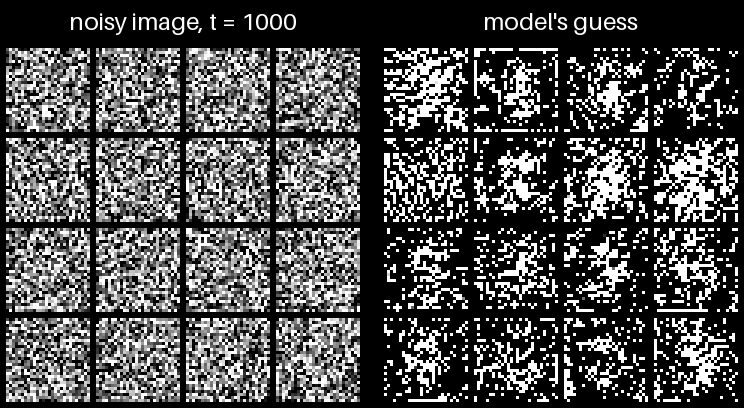

# matchue-diffusion

A small diffusion model, written from scratch in PyTorch, that learns to draw
handwritten digits. It's the companion code to the Matchue video on diffusion:
I wrote it while making the video to make sure I understood diffusion well
enough to explain it. It's short, heavily commented, and meant to be read,
changed, and broken.



*Every frame uses the same 64 noise images and the same random seed, so you're
watching the same digits form as the model learns. 10,000 training steps, about 7 minutes on an
RTX 5080.*



*Generating 16 digits with the trained model, from pure static (t = 1000) to
finished digits (t = 0). The right side is the model's guess at the clean image
at each step: blurry while the image is mostly noise, then sharper as the
digits commit. Watch the top-right digit change its mind from a 1 to a 3.*

## What's in here

| File | What it does |
|---|---|
| [`src/dataset.py`](src/dataset.py) | Loads MNIST onto the GPU and scales pixels to [-1, 1] |
| [`src/diffusion.py`](src/diffusion.py) | The noise schedule, the training loss, and the sampler |
| [`src/model.py`](src/model.py) | A U-Net (3.2M parameters) that predicts the noise in an image |
| [`src/train.py`](src/train.py) | The training loop, with checkpoints and sample grids |
| [`src/sample.py`](src/sample.py) | Generate new digits from a trained checkpoint |
| [`src/timelapse.py`](src/timelapse.py) | Turn a run's sample grids into a GIF like the one above |

## How it works, in five steps

1. **Destroying images is easy.** Blend an image with random noise. With enough
   noise, it's pure static. A single formula jumps straight to any noise level
   `t` from 1 to 1,000, so there's no need to add noise step by step.
2. **The model learns to spot the noise.** Show it a noisy image and its noise
   level `t`, and train it to predict exactly which noise was mixed in. That's
   the whole training objective: plain squared error against noise we know.
3. **Heavy noise teaches the big picture, light noise teaches detail.** When
   an image is mostly static, the best guess is a blurry average of every
   plausible digit. When it's barely noisy, the job is fixing edges. One model
   learns both, and `t` tells it which job it's doing.
4. **Generation runs it in reverse.** Start from pure static. At each step, the
   model guesses the clean image, the sampler moves a small step toward that
   guess, and adds a little fresh randomness. After 1,000 small steps, a digit
   has formed.
5. **The noise decides the digit.** That's the starting static *and* the fresh
   randomness added at every step. Fix the seed and you get the same digit every
   time, and often the same digit even from a different model. Keep the starting
   static but change the later randomness, and you usually get a different digit.

The comments in `diffusion.py` and `model.py` go into each piece in more depth.

## Running it

You'll need Python 3.10 or newer and an NVIDIA GPU. The code runs on CUDA and
uses bfloat16, so it needs an RTX 30-series or newer.

```bash
python -m venv .venv
```

```bash
.venv/Scripts/python -m pip install -r requirements.txt
```

On macOS or Linux, use `.venv/bin/python` instead of `.venv/Scripts/python`.

Train a model. It downloads MNIST (about 11 MB) on the first run:

```bash
.venv/Scripts/python src/train.py
```

Everything for a run lands in `outputs/runs/<run>/`: a checkpoint, a `log.csv`,
and a sample grid every 500 steps. Press Ctrl+C to stop; running the same
command again resumes from the checkpoint. Pass `--run <name>` to keep separate
runs, and `--help` to see every setting.

Then make some digits or a timelapse. Add `--gif` to `sample.py` to also save
the denoising process, like the second GIF above:

```bash
.venv/Scripts/python src/sample.py --seed 42
```

```bash
.venv/Scripts/python src/sample.py --count 16 --seed 7 --gif
```

```bash
.venv/Scripts/python src/timelapse.py
```

## Things to try

- **Train longer** (`--steps 30000`) and watch the wobbly digits clean up.
- **Swap the noise schedule** to `linear_betas`, the original DDPM schedule,
  and compare the results. Change it in both `train.py` and `sample.py`.
- **Make the model bigger or smaller** with the `channels` and `attention`
  settings in `model.py`.
- **Try CIFAR-10** or another dataset. `dataset.py` is the main change, plus the
  image shape and channel count in `sample.py`.
- **Sample in fewer steps.** Training never depends on the step size, so a
  sampler that jumps 20 steps at a time (look up DDIM) works with the same
  trained model.

## References

- Ho, Jain & Abbeel, [Denoising Diffusion Probabilistic Models](https://arxiv.org/abs/2006.11239) (2020): the method implemented here.
- Nichol & Dhariwal, [Improved Denoising Diffusion Probabilistic Models](https://arxiv.org/abs/2102.09672) (2021): the cosine noise schedule.
- Song, Meng & Ermon, [Denoising Diffusion Implicit Models](https://arxiv.org/abs/2010.02502) (2020): faster sampling with the same model.
- Lilian Weng, [What are Diffusion Models?](https://lilianweng.github.io/posts/2021-07-11-diffusion-models/): a deeper walkthrough of the math.

## License

MIT. Use it, change it, and make it your own. See [LICENSE](LICENSE).
